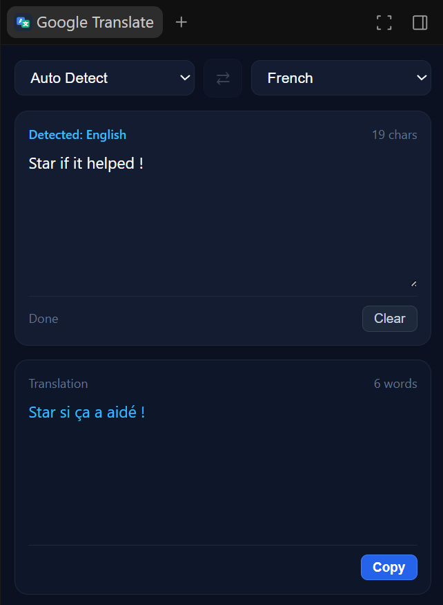

# Google Translate for Antigravity

An integrated, zero-token auxiliary side-panel plugin for Google Antigravity. Translate code comments, documentation, and arbitrary text directly inside the IDE workspace without context switching or third-party browser tabs.

<div align="center">
  
</div>

---

## Overview

Working with multilingual documentation, foreign-language codebases, or prompt engineering across languages typically requires switching between your editor and external translation tools.

This plugin embeds a lightweight Google Translate interface into Antigravity's auxiliary side panel. It operates as a local background process with instant translation, automatic language detection, and zero model token overhead.

---

## Key Features

- **Zero Token Overhead:** Translations are processed directly through Google's public translation endpoints, avoiding AI model invocations and preserving your API quotas.
- **Resilient Multi-Tier Fallback & Caching:** Multi-endpoint failover architecture with in-memory caching to eliminate rate limits (HTTP 429) and network drops.
- **Minimal, Focused Interface:** Designed specifically for developer workflows with a clean dual-pane layout, character counting, manual translate trigger, and one-click clipboard copying.
- **Automatic Language Detection:** Identifies source languages automatically as you type, supporting code comments, single terms, or multi-paragraph text.
- **Bi-directional Swapping:** Instantly invert source and target languages using the swap action (`⇄`).
- **Keyboard Shortcuts:** Trigger instant translation on demand using `Ctrl+Enter` (`Cmd+Enter` on macOS).
- **Broad Language Support:** Full support for major technical and global languages, including English, French, Arabic, Spanish, German, Italian, Portuguese, Russian, Turkish, Chinese, Japanese, Korean, and more.

---

## Installation

Clone this repository into your Antigravity plugins directory:

### Windows (PowerShell)
```powershell
git clone https://github.com/MohamedTaherBorgi/Google-Translate-for-Antigravity-Plugin.git "$HOME\.gemini\config\plugins\translator"
```

### macOS / Linux
```bash
git clone https://github.com/MohamedTaherBorgi/Google-Translate-for-Antigravity-Plugin.git ~/.gemini/config/plugins/translator
```

### Activation
1. In Antigravity, open **Customizations &rarr; Plugins**.
2. Toggle **Google Translate** (`translator`) to **Enabled**.
3. Python 3 (`python` in system PATH) is required to run the local sidecar runtime.

---

## Usage

1. Open the **Google Translate** panel from Antigravity's auxiliary side pane.
2. Select your target language (default: English).
3. Type or paste text into the input field. Translations update automatically with brief input debouncing, or upon pressing `Ctrl+Enter`.
4. Click **Copy** to place the translated output into your system clipboard.

---

## Technical Details

- **Runtime:** A local lightweight HTTP server binds to loopback (`127.0.0.1`) using a dynamically assigned sidecar port.
- **Privacy:** Translations are sent securely over HTTPS directly to the translation service. No conversation history, file contents, or personal identifiers are stored or forwarded to third parties.

---

## Project Structure

```text
translator/
├── plugin.json                    # Plugin manifest
├── README.md                      # Documentation
├── assets/
│   └── logo.svg                   # Plugin icon
└── sidecars/
    └── translator/
        ├── sidecar.json           # Sidecar registration configuration
        └── server.py              # Local runtime & translation web UI
```

---

## License

MIT License. Contributions and improvements are welcome.
